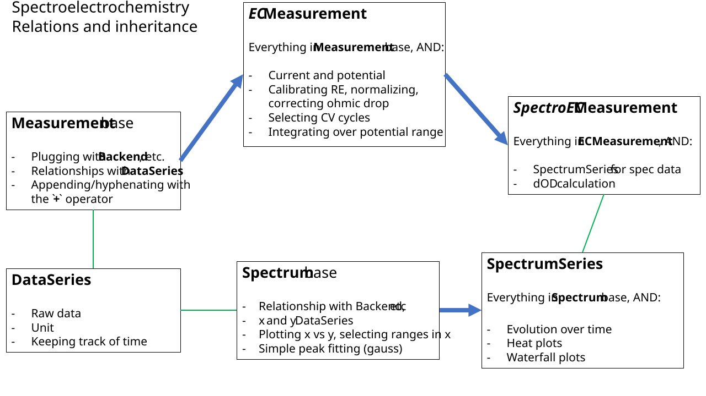

.. _sec:

Spectro-Electrochemistry
========================

Spectro-Electrochemistry (SEC) can refer to (i) a broad range of in-situ techniques
hyphenating electrochemistry to some kind of spectrometry (see e.g.
`Lozeman et al, 2020 <https://doi.org/10.1039/c9an02105a>`_
) or (ii) more specifically,
the combination of electrochemistry and visible-light spectroscopy. In ``ixdat``, we
use the latter meaning.

SEC data is organized in a ``SpectroECMeasurement``, which inherits from ``ECMeasurement``
(see :ref:`electrochemistry`) and uses a ``SpectrumSeries`` (see :ref:`Spectra <spectra>`)
for managing the 2-D data array formed by the sequential spectra (see Figure).
For optical spectroscopy, the class is ``ECOpticalMeasurement``, which adds delta
optical density (dOD) calculations. Methods such as ``calc_dOD``, ``get_dOD_spectrum``,
and ``track_wavelength`` take as an optional argument a specification of the
time/potential/spectrum index to use as the reference for optical density calculation.
If not provided, the object's ``reference_spectrum`` is used, which itself can be set by
the ``set_reference_spectrum`` method.

The data structure is the same whether the experiment is done as a slow potential scan with
adsorption vs potential in mind, or as a potential jump or release with time-resolved
behavior in mind.

Plots of SEC are made by the  :ref:`SECPlotter <sec-plotter>`. These are either heat plots
(``plot_measurement`` and ``plot_vs_potential``) or coplotted cross-sections (``plot_waterfall``
and ``plot_wavelengths``). :ref:`Exporting SEC data <sec-exporter>` results in a master file with
the EC data and any tracked wavelengths and two auxiliary files with (i) the
spectrum series and (ii) the reference spectrum.

A :ref:`jupyter notebook tutorial <sec-tutorial>` for SEC is available.

Combining electrochemistry and optical spectra
----------------------------------------------

Optical spectra are read as an ``OpticalSpectrumSeries`` (see :ref:`readers`) and added
to an electrochemistry measurement::

    >>> from ixdat import Measurement, Spectrum
    >>> cv = Measurement.read("my_cv.mpt", reader="biologic").as_cv()
    >>> optical = Spectrum.read("my_spectra.txt", reader="oceanview")
    >>> sec = cv + optical

The result, ``sec``, is an ``ECOpticalMeasurement``. How it calculates dOD depends on
the ``spectra_type`` of the spectra:

- Intensity: ``dOD = -log10(I / I_ref)``. A reference spectrum is needed.
- Transmission (in %): ``dOD = -log10(T / T_ref)``.
- Absorption: ``dOD = A - A_ref``.

For transmission and absorption data, the reference spectrum can be left out. The data
is then taken as already referenced by the software that recorded it.

Calculations
------------

The calculations are done by three calculators in ``ixdat.calculators.sec_calculators``.
You get their results by looking them up in the measurement, like any other series.
The end of the name says what to calculate: ``sec["dOD>diff>smooth"]`` gives the
smoothed (``>smooth``) difference spectra (``>diff``) of the dOD.

- The ``DeltaODCalculator`` comes with every ``ECOpticalMeasurement``, as
  ``sec.dOD_calculator``. It gives the dOD, ``sec["dOD"]``, and the difference spectra,
  ``sec["dOD>diff"]``. Set the step between difference spectra in spectrum index
  (``idx_step``), time (``tstep``) or potential (``Vstep``) on the calculator.
- The ``Denoiser`` smooths spectra, by principal component analysis (PCA, which needs
  the ``scikit-learn`` package) or a Savitzky-Golay filter.
- The ``SpectrumDeconvolutor`` finds the converged spectra, where the difference spectra
  stop changing shape, and fits the dOD as a sum of them. It gives the fit coefficients,
  ``sec["coefficient_0"]``, ``sec["coefficient_1"]``, ..., and ``sec["reconstructed"]``
  and ``sec["residuals"]``.

An example on one anodic sweep::

    >>> from ixdat.calculators.sec_calculators import Denoiser, SpectrumDeconvolutor
    >>> cv.redefine_cycle(turning_point=True)  # a new cycle each time the sweep turns
    >>> sec = cv + optical
    >>> sec.set_reference_spectrum(V_ref=0.4)
    >>> sweep = sec.select(cycle=1)
    >>> sweep.dOD_calculator.Vstep = 0.005  # 5 mV between difference spectra
    >>> sweep.add_calculator(Denoiser(denoise_method="Savitzky-Golay"))
    >>> sweep.plot_dOD_difference_spectra(field=sweep["dOD>diff>smooth"])
    >>> decon = SpectrumDeconvolutor.from_spectromeasurement(sweep, xspan=[400, 900])
    >>> sweep.add_calculator(decon)
    >>> sweep.plot_converged_spectra()
    >>> sweep.plot_fit_and_residuals()

The calculators are saved together with the measurement. A ``SpectrumDeconvolutor`` can
also be added to another measurement, to fit it with the same converged spectra.

Calculated series are stored once looked up. After changing a calculator's settings,
call ``sec.clear_cache()`` to calculate them again.

The ``spectroelectrochemistry`` module
......................................

.. automodule:: ixdat.techniques.spectroelectrochemistry
    :members:

The ``sec_calculators`` module
..............................

.. automodule:: ixdat.calculators.sec_calculators
    :members:
